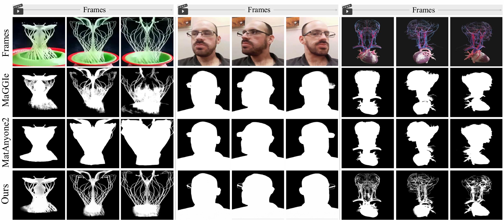

<h1 align="center">
SAM2Matting: Generalized Image and Video Matting
</h1>

<p align="center">
  <strong>Ruiqi Shen</strong><sup style="font-size: 0.7em;">*1</sup>
  ·
  <strong>Guangquan Jie</strong><sup style="font-size: 0.7em;">*1</sup>
  .
  <a href="https://scholar.google.com/citations?user=XlQP0GIAAAAJ&hl=zh-CN"><strong>Chang Liu</strong></a><sup style="font-size: 0.7em;">2✉️</sup>
  ·
  <a href="https://henghuiding.com/"><strong>Henghui Ding</strong></a><sup style="font-size: 0.7em;">1✉️</sup>
</p>

<p align="center">
  <sup>1</sup>Fudan University &nbsp;&nbsp;
  <sup>2</sup>Shanghai University of Finance and Economics  &nbsp;
</p>

<p align="center">
  <a href="https://henghuiding.com/SAM2Matting/"></a>
  <a href="https://arxiv.org/abs/2606.27339"></a>
  <a href="https://huggingface.co/FudanCVL/SAM2Matting"></a>
</p>

<p align="center">
  <strong>SAM2Matting</strong> is a generalized matting framework that decouples high-level tracking from dedicated low-level matting.
  It supports <strong>diverse prompts</strong> for robust image & video matting of any <strong>open-world targets.</strong>
</p>

<p align="center" style="margin-bottom:0.5em;">
  
</p>

<p align="center" style="margin-top:0.4em; margin-bottom:1em;">
  🎥 For more visual results, slider comparisons, and demo, visit our
  <a href="https://henghuiding.com/SAM2Matting"><b>project page</b></a>.
</p>

<!-- --- -->

## ✨ Highlights

- **Decoupled design** — VOS tracker for temporal consistency + ROI Detection & Progressive Matting for fine details
- **Image-only training, video SOTA** — Strong zero-shot video matting without costly video matting datasets
- **Diverse prompts** — Masks, points, boxes, text
- **Open-world generalization** — Humans, animals, anime, translucent objects, rapid-motion scenes

## 📋 TODO

- ✅ Release checkpoints of different variants.
- ✅ Release inference code and interactive demo.
- ⬜ Release training code.

## 🧠 Checkpoints
We provide three variants of SAM2Matting based on different VOS trackers.

<table>
  <thead>
    <tr>
      <th>Backbone Tracker</th>
      <th>Hugging Face</th>
    </tr>
  </thead>
  <tbody>
    <tr>
      <td style="vertical-align: middle;">SAM2.1-T</td>
      <td style="vertical-align: middle;"><a href="https://huggingface.co/FudanCVL/SAM2Matting/blob/main/checkpoints/SAM2Matting-SAM2.1Tiny.pt"></a></td>
    </tr>
    <tr>
      <td style="vertical-align: middle;">SAM2.1-B+</td>
      <td style="vertical-align: middle;"><a href="https://huggingface.co/FudanCVL/SAM2Matting/blob/main/checkpoints/SAM2Matting-SAM2.1Base%2B.pt"></a></td>
    </tr>
    <tr>
      <td style="vertical-align: middle;">SAM3</td>
      <td style="vertical-align: middle;"><a href="https://huggingface.co/FudanCVL/SAM2Matting/blob/main/checkpoints/SAM2Matting-SAM3.pt"></a></td>
    </tr>
  </tbody>
</table>

By default, place all checkpoints under the `checkpoints/` directory.

## ⚙️ Installation
```bash
# clone the repo and enter directory
git clone https://github.com/Hansello218/SAM2Matting.git
cd SAM2Matting

# create and activate conda environment
conda create -n sam2matting python=3.10 -y
conda activate sam2matting

# install required packages
pip install -r requirements.txt
```

## 批量 Matting 接口（主要入口）

本仓库使用 `batch_sam2matting_original.py` 作为多相机静态图像的主要启动接口。它接收原始 RGB 图像和 SAM2 粗 mask，调用原版 SAM2Matting Tiny 推理逻辑生成连续 alpha matte，并输出可直接交给 2DGS-Maskaware 使用的数据目录。

该接口固定使用：

```text
configs/sam2matting-sam2.1tiny.yaml
checkpoints/SAM2Matting-SAM2.1Tiny.pt
```

模型权重未提交到 GitHub。请下载 Tiny 权重并放到指定位置：

```bash
mkdir -p checkpoints

wget -O checkpoints/SAM2Matting-SAM2.1Tiny.pt \
  https://huggingface.co/FudanCVL/SAM2Matting/resolve/main/checkpoints/SAM2Matting-SAM2.1Tiny.pt
```

### 输入目录

图像和 mask 通过相同的文件 stem 配对，扩展名可以不同：

```text
INPUT_IMAGES/
├── 001.jpg
├── 002.jpg
└── 003.jpg

INPUT_MASKS/
├── 001.png
├── 002.png
└── 003.png
```

- `--images`：原始 RGB 图像目录；
- `--masks`：SAM2 粗分割 mask 目录；
- 粗 mask 默认以 `128` 为阈值转为二值提示；
- 如果 mask 尺寸与 RGB 不同，程序会使用最近邻插值对齐；
- 找不到同 stem mask 的图像会被跳过并计入 `Missing mask`。

### 运行命令

```bash
conda activate sam2matting
cd /home/jupiterdev/chao_wp/SAM2Matting

CUDA_VISIBLE_DEVICES=0 \
python -u batch_sam2matting_original.py \
  --images /path/to/original_images \
  --masks /path/to/sam2_coarse_masks \
  --output /path/to/output \
  --overwrite
```

实际数据示例：

```bash
CUDA_VISIBLE_DEVICES=0 \
python -u batch_sam2matting_original.py \
  --images /home/jupiterdev/chao_wp/Datasets/4dgs/ziqi/frame_selected/0 \
  --masks /home/jupiterdev/chao_wp/Datasets/4dgs/ziqi/masks/0 \
  --output /home/jupiterdev/chao_wp/Datasets/4dgs/ziqi/matting_tiny_original/0 \
  --overwrite
```

### 输出目录

```text
OUTPUT/
├── images/
│   ├── 001.jpg
│   ├── 002.jpg
│   └── ...
└── masks/
    ├── 001.png
    ├── 002.png
    └── ...
```

- `images/*.jpg`：原始 RGB 与预测 alpha 预乘得到的黑背景图，即 `I_black = I_original × alpha`；
- `masks/*.png`：单通道 `uint8` 连续 alpha，数值范围为 `0–255`；
- 黑背景图默认以 JPEG quality 95、无色度子采样方式保存；
- 不使用 `--overwrite` 时，只有黑背景图和 alpha 都已存在的样本才会被跳过。

输出的 `masks/*.png` 是连续透明度而不是普通二值 mask：`0` 表示完全背景，`255` 表示完全不透明前景，中间值表示发丝、抗锯齿轮廓或半透明区域。

### 可选参数

| 参数 | 默认值 | 作用 |
|---|---:|---|
| `--mask_threshold` | `128` | SAM2 粗 mask 二值化阈值，范围 `0–255` |
| `--jpeg_quality` | `95` | 黑背景 JPG 保存质量，范围 `1–100` |
| `--limit` | `0` | 仅处理前 N 张；`0` 表示全部 |
| `--overwrite` | 关闭 | 覆盖已有的完整输出对 |

快速测试前两张图：

```bash
CUDA_VISIBLE_DEVICES=0 \
python -u batch_sam2matting_original.py \
  --images /path/to/original_images \
  --masks /path/to/sam2_coarse_masks \
  --output /path/to/test_output \
  --limit 2 \
  --overwrite
```

## 🚀 Inference

We provide separate inference scripts for **image** and **video** matting (given initial-frame mask), organized by tracker family:

| Task | SAM2 variants | SAM3 variant |
|------|------------------------------------------|--------------|
| **Image matting** | `inference_image_sam2.py` | `inference_image_sam3.py` |
| **Video matting** | `inference_video_sam2.py` | `inference_video_sam3.py` |

For video matting, use `--save_mp4` to save video, and optionally use `--compiled` to enable compilation (first-time may be slow), such as:

```bash
python inference_video_sam2.py --save_mp4
python inference_video_sam2.py --save_mp4 --compiled
```

You can replace the samples with your own image or video.


## 🎮 Interactive Demo
SAM2Matting supports interactive prompt types beyond masks, including point, box (SAM2 & SAM3), and text (SAM3), run the code below:
```bash
python interactive_sam2.py (point by default)
python interactive_sam3.py (text by default)
```


## 📚 Acknowledgements & Citation

We are inspired by the following excellent works: [SAM2](https://github.com/facebookresearch/sam2), [SAM3](https://github.com/facebookresearch/sam3), [MatAnyone](https://github.com/pq-yang/MatAnyone), and many other not listed.

If you find SAM2Matting useful in your research, please consider citing:

```bibtex
@inproceedings{SAM2Matting,
  title={{SAM2Matting}: Generalized Image and Video Matting},
  author={Shen, Ruiqi and Jie, Guangquan and Liu, Chang and Ding, Henghui},
  booktitle={European Conference on Computer Vision (ECCV)},
  year={2026}
}
```
## ⚖️ License
SAM2Matting is licensed under CC BY-NC-SA 4.0 for non-commercial research use only. For uses beyond this license, please contact henghui.ding[AT]gmail.com.
